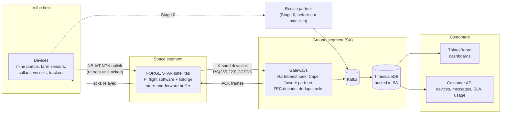
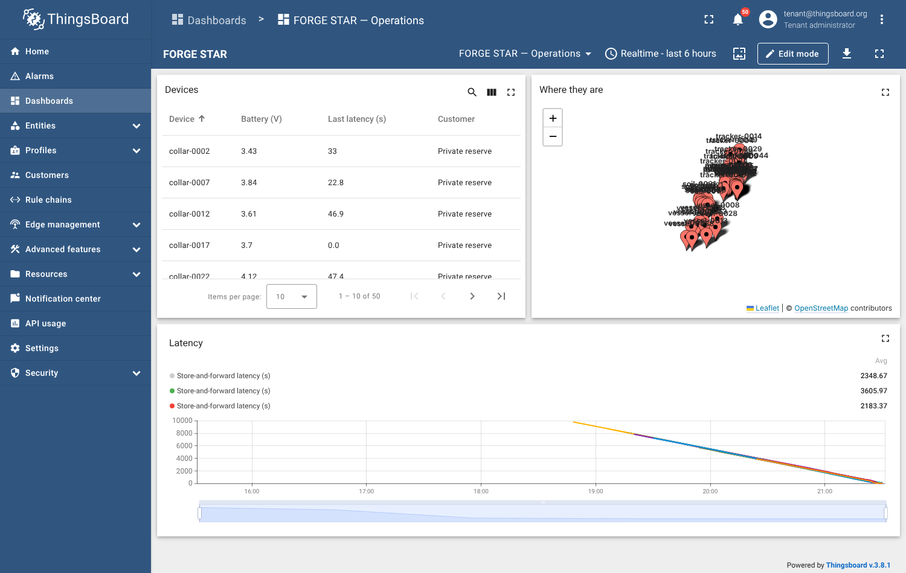

# FORGE STAR

**Africa's sovereign satellite data network.** Locally owned low-Earth-orbit (LEO) infrastructure that connects the assets, vessels and people that terrestrial networks will never reach. Data is landed and hosted in South Africa.

FORGE STAR starts with satellite IoT, maritime AIS and sovereign data relay, not consumer broadband. It runs as a ground and services company first (revenue before orbit), then becomes a satellite operator. It's part of the FORGE ecosystem (MYFORGE PTY LTD).

[](https://github.com/KHAYAAI/FORGE-STAR/actions/workflows/ci.yml)

> All figures are illustrative. Regulatory and market facts need confirming by counsel before external use (see [`docs/verification/VERIFY.md`](docs/verification/VERIFY.md)). Not financial advice.

---

## The platform in one picture



**How a message travels:**
1. A device sends a reading. Every FORGE STAR satellite overhead takes a copy and holds it on board.
2. When a satellite passes over a gateway, it sends its stored messages down in error-corrected link blocks.
3. The gateway decodes them, removes duplicate copies and records each message. It then sends acknowledgements back up.
4. Satellites relay the acknowledgements, so devices stop re-sending and satellites drop copies they no longer need.
5. Messages flow through Kafka into TimescaleDB, hosted in South Africa. Customers see them in ThingsBoard dashboards and through the API.

In **Stage 0**, before our own satellites fly, the same platform carries traffic from a resale partner. Customers get the same dashboards and API, then move onto our satellites with no change on their side.

---

## What's in this repository

| Layer | What it does | Where |
|---|---|---|
| **Flight software** | NASA F´ deployment (`Payload`): store-and-forward, signed-command authentication, safe mode, onboard pass prediction, persistence. Runs on x86 and 64-bit ARM. | [`flight/fprime/`](flight/fprime) |
| **Flight core** | Portable C99, no dynamic memory: store-and-forward buffer (CRC-checked, survives reboot), frames, acks, Reed–Solomon, HMAC command auth, pass predictor. Byte-identical to the ground code. | [`flight/libforge/`](flight/libforge) |
| **Device SDK** | C99 library for customer devices: queue, re-send until acked, expiry | [`flight/libforge/include/forge_device.h`](flight/libforge/include/forge_device.h) |
| **Mission operations** | Signed commanding and telemetry/event decoding for the flight software; procedures | [`ground/ops/`](ground/ops), [`docs/operations/`](docs/operations) |
| **Software modem** | BPSK receive chain from IQ samples (Doppler, timing, phase) to link blocks | [`forgestar/modem.py`](forgestar/modem.py) |
| **Link layer** | RS(255,223) with CCSDS parameters and dual basis, CCSDS randomiser, sync marker. Corrects up to 16 bad bytes per block. | [`forgestar/fec.py`](forgestar/fec.py) |
| **Frames** | Store-and-forward data frames and ACK frames shared by satellite and ground | [`forgestar/frames.py`](forgestar/frames.py) |
| **Gateway** | Decodes downlinks (Kafka, capture files, SatNOGS Network), removes duplicates, sends acks | [`ground/gateway/`](ground/gateway) |
| **Data platform** | Kafka → TimescaleDB, ingest, delivery-time (SLA) views | [`ground/`](ground) |
| **Dashboards** | ThingsBoard provisioning: devices plus an operations dashboard | [`ground/thingsboard/`](ground/thingsboard) |
| **Customer API** | FastAPI with per-customer keys: devices, messages, SLA, monthly usage; rate limits, audit log, metrics | [`ground/api/`](ground/api) |
| **Production deployment** | TLS, backups, no exposed data ports, required secrets | [`ground/deploy/`](ground/deploy) |
| **Simulated space segment** | Runs a constellation on a sped-up clock, so the whole platform can be tested without satellites | [`ground/sandf/`](ground/sandf) |
| **Constellation design** | Orbits with J2 (checked against SGP4), coverage, link budget, antenna options, delivery time | [`sim/`](sim), [`forgestar/`](forgestar) |
| **Hardware** | In-house PCB pipeline: circuit as code (SKiDL) → KiCad → Freerouting → fab files. Board 1: payload interface board. | [`hardware/`](hardware) |
| **Business** | Financial model (Stages 0–3, stress scenarios, monthly cash, 30% ownership check) | [`model/`](model) |
| **Readiness** | 30 outside milestones (ICASA/ITU, funding, partners, customers), TRL tracking, launch readiness report | [`readiness/`](readiness), [`docs/LAUNCH_READINESS.md`](docs/LAUNCH_READINESS.md) |
| **Strategy** | The full strategy; the PDF is built from it | [`docs/strategy.md`](docs/strategy.md), [`output/`](output) |



---

## Run it

**Prerequisites:** Docker, Python 3.11+, a C compiler. For the flight software you also need CMake and F´'s tools; for hardware, KiCad 7+.

```bash
git clone --recurse-submodules https://github.com/KHAYAAI/FORGE-STAR.git
cd FORGE-STAR
pip install -r requirements.txt
```

**The platform** (simulated devices and satellites, gateway, database, API):

```bash
cd ground && docker compose up -d
```

Then:
- **Customer API docs:** http://localhost:8000/docs (create a key with `docker compose exec api python app.py create-key "FORGE Freight"`)
- **Delivery times:** `docker compose exec timescaledb psql -U forge -d forgestar -c "select * from latency_sla;"`
- **With ThingsBoard** (needs about 2 GB of RAM): `docker compose --profile full up -d`, then `python3 thingsboard/provision.py`, and open http://localhost:8080 (`tenant@thingsboard.org` / `tenant`)

**Flight software:**

```bash
cd flight/fprime && pip install -r fprime/requirements.txt
fprime-util generate && fprime-util build && fprime-util check     # build + unit tests
cd ../.. && python3 flight/run_payload.py                           # run it, decode its downlink on the ground
```

Command it (signed) from the ground: `python3 ground/ops/forge_ops.py --dict flight/fprime/build-artifacts/Linux/Payload/dict/PayloadTopologyDictionary.json --port 50000 --key <hex> --cmd Payload.cmdDisp.CMD_NO_OP`, then start the flight binary with `FORGE_CMD_KEY=<hex>` and `-a 127.0.0.1 -p 50000`.

For 64-bit ARM, use `fprime-util generate aarch64-linux && fprime-util build aarch64-linux`, then `python3 flight/run_payload.py --arch aarch64` (runs under QEMU).

**Analysis and documents:**

```bash
python3 sim/equatorial_study.py          # Stage 3 constellation and gateway design
python3 model/financial_model.py         # financial model and stress tests
python3 scripts/launch_readiness.py      # docs/LAUNCH_READINESS.md
python3 scripts/build_pdf.py             # output/FORGE_STAR_Strategy.pdf
python3 -m pytest                        # test suite
```

CI runs all of this on every push: the Python tests and analysis, the platform image builds, the flight software (C core, F´ unit tests, native and ARM runs), and the hardware pipeline.

---

## Key numbers (illustrative)

| Item | Value |
|---|---|
| **Stage 3 constellation** | 42 satellites at 45° + 6 at 10° (48), 550 km |
| **Gateways** | Hartebeesthoek, Cape Town, Walvis Bay, Mauritius, Malindi, Lagos |
| **Delivery target (design)** | 95% of messages within 26 minutes at all 7 modelled customer sites |
| **Delivery measured (live run)** | 95% within ~40 minutes on 24 satellites with SA gateways only |
| **Year-6 revenue** | $37.5M base; $31.6M with IoT at ~$1/device; $19.5M without a government contract |
| **Equity to Stage 3** | ~$50M |
| **First payload in orbit** | ~Feb 2029 on the fast track |

## Status

The software and ground platform are at TRL 4–5. Everything that can be built without hardware is in place; the remaining software (payload radio base station, real drivers, bus integration) needs the lab kit and bus partner. Payload hardware, the bus partner, spectrum licensing, funding and customers are the work still ahead. See [`docs/LAUNCH_READINESS.md`](docs/LAUNCH_READINESS.md) for the scorecard, critical path and blockers.

Project context for Claude Code is in [`CLAUDE.md`](CLAUDE.md).
