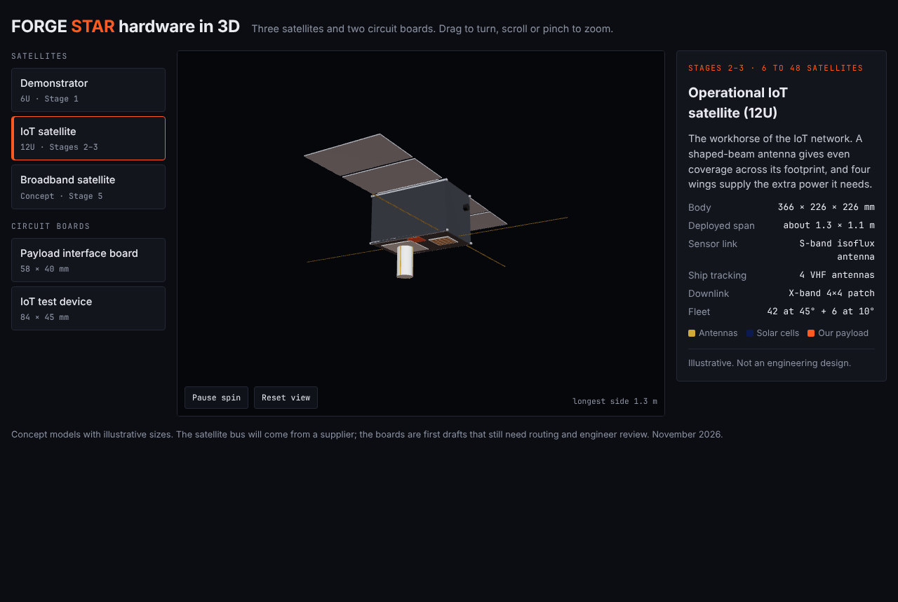
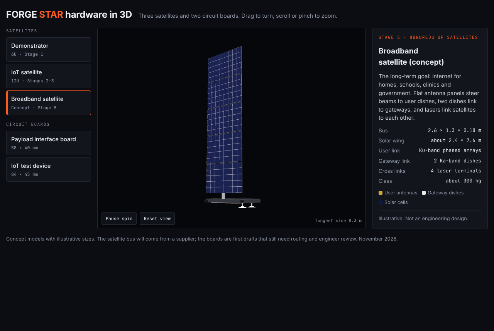

# FORGE STAR 3D models

Concept 3D models for presentations and early mechanical discussion. Sizes are illustrative. They are not
engineering designs: the satellite bus will come from a supplier (Dragonfly Aerospace or CubeSpace).

| Model | Stage | Size (illustrative) | Files |
|---|---|---|---|
| Demonstrator satellite, 6U | 1 | 366 x 226 x 100 mm body; about 0.83 x 0.68 m deployed | `out/sat-demo-6u.step`, `.glb` |
| Operational IoT satellite, 12U | 2-3 | 366 x 226 x 226 mm body; about 1.3 x 1.1 m deployed | `out/sat-iot-12u.step`, `.glb` |
| Broadband satellite concept | 5 | 2.6 x 1.3 x 0.18 m bus; about 2.4 x 7.6 m solar wing | `out/sat-broadband-concept.step`, `.glb` |
| Payload interface board | 1-3 | 58 x 40 mm | `../zener/boards/pib/pib.step` |
| IoT test device | 0-1 | 84 x 45 mm | `../zener/boards/iot_node/iot_node.step` |

STEP files open in FreeCAD, Fusion, SolidWorks and other CAD tools. GLB files open in any 3D viewer.

```bash
pip install cadquery
python3 hardware/3d/satellites.py        # rebuilds the satellite STEP and GLB files
kicad-cli pcb export glb --subst-models --include-tracks --include-pads --include-zones \
  --include-silkscreen --include-soldermask -o hardware/3d/out/board-pib.glb hardware/zener/boards/pib/eda/pib.kicad_pcb
```

`viewer.html` is the source of the interactive 3D viewer page. It loads the GLB files from a `models/` folder.



