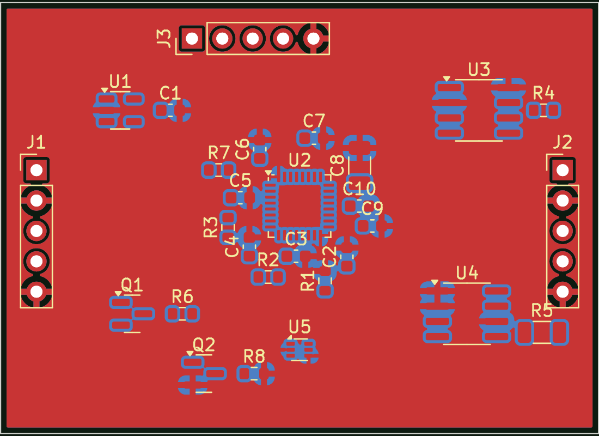

# FORGE STAR hardware: in-house PCB pipeline

An open-source replacement for an AI PCB service such as heypcb.ai. Boards are written as code,
checked automatically and turned into fab files on every push.

```
circuit as code (SKiDL, KiCad symbol libraries)      hardware/boards/<board>/<board>.py
   │  electrical rule check (ERC) + netlist
   ▼
placement + rules (KiCad pcbnew Python API)          hardware/tools/forge_pcb.py
   │  autoroute (Freerouting, opt-in)
   ▼
ground pours + design rule check (DRC)
   │
fab package: Gerbers, drill, pick-and-place, BOM, SVG   hardware/build/<board>/<board>-fab.zip
```

## Run

```bash
sudo apt-get install kicad kicad-symbols kicad-footprints      # KiCad 7+
pip install --no-deps skidl graphviz simp_sexp
python3 hardware/boards/pib/pib.py                               # ERC, netlist, placed PCB, DRC, fab files
FREEROUTING_JAR=/path/to/freerouting-1.9.0.jar python3 hardware/boards/pib/pib.py   # + autoroute
```

## Boards

| Board | What | Status |
|---|---|---|
| `pib` payload interface board rev A | STM32L432 running libforge, CAN to bus, radio power switch, INA219 current, TMP117 temperature, SWD | ERC clean (0 errors); placed; DRC 0 blocking issues before routing; not yet autorouted |



## What each open-source tool replaces

| heypcb.ai feature | Open-source equivalent here | Notes |
|---|---|---|
| Describe a circuit, get a schematic | **SKiDL** (Python) or **atopile** (declarative); Claude Code writes the code | Circuits are reviewable diffs, testable in CI |
| Component library | **KiCad symbol/footprint libraries** (10k+ parts) | Add JLCPCB/LCSC parts with `kicad-jlcpcb-tools` |
| "Circuit World" of open boards to fork | **LibreCube, OreSat, PyCubed, BIRDS** (all KiCad, open hardware) | Fork proven CubeSat boards instead of starting blank |
| Placement | `forge_pcb.py` (anchor ICs, auto-place passives near their IC) | Good enough for low-speed boards; RF boards still need hand placement |
| Autorouting | **Freerouting** | Fine for digital/power boards; RF and high-speed routed by hand |
| Design checks | KiCad **ERC/DRC** (scripted) | Blocking vs review categories in the DRC summary |
| Gerbers, BOM, pick-and-place | **kicad-cli** (+ KiBot for richer outputs) | Zip ready for JLCPCB, PCBWay or an SA fab |
| Simulation | **ngspice** (circuits), **openEMS** (antennas, RF) | openEMS covers the patch/isoflux antenna work |
| Mechanical fit | **FreeCAD** + KiCad StepUp | Check board against the CubeSat frame |

What neither heypcb nor this pipeline does: radiation qualification, thermal design, RF tuning on a vector network analyser, and bus integration. Those stay with the engineers and the bus partner.
