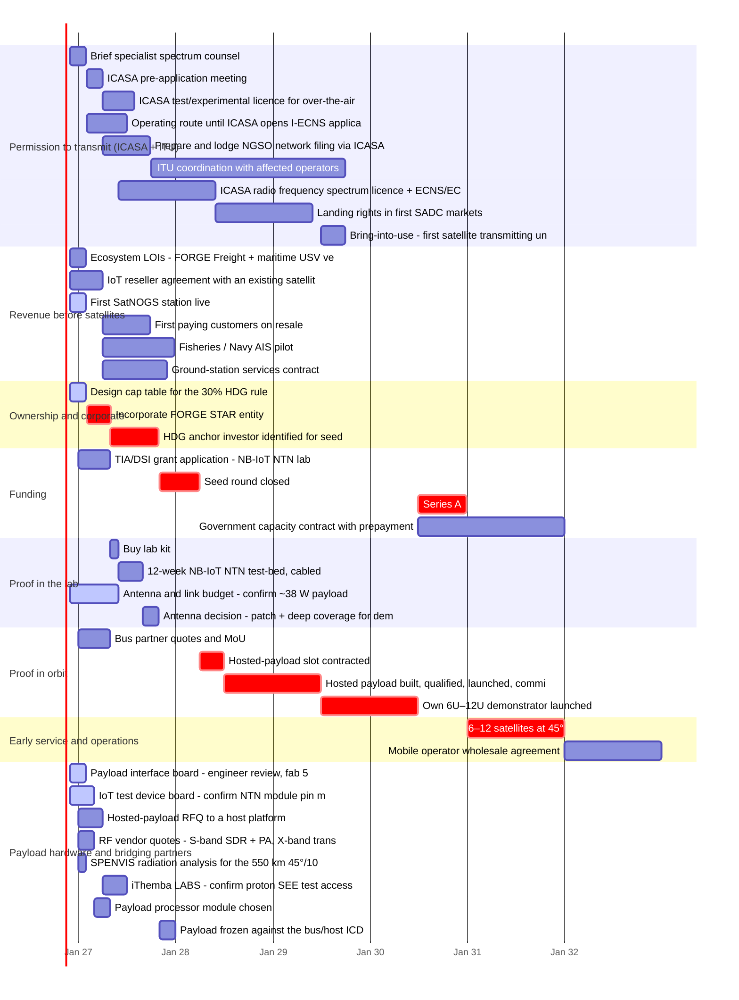

# FORGE STAR readiness status

Generated by `readiness/tracker.py` on 2026-11-12 from `readiness/readiness.yaml`. Plan start 2026-12-01. 0/40 items done.

## Critical path to 6–12 satellites at 45° (Stage 2 early service)

Earliest finish: **2032-01-01** (month 61).

| # | Item | Starts | Ends | Status |
|---|---|---|---|---|
| O1 | Design cap table for the 30% HDG rule (model/assumptions.yaml ownership) | 2026-12-01 | 2027-02-01 | doing |
| O2 | Incorporate FORGE STAR entity; shareholder agreement; HDG verification | 2027-02-01 | 2027-05-01 | todo |
| O3 | HDG anchor investor identified for seed (IDC / NEF / BEE fund) | 2027-05-01 | 2027-11-01 | todo |
| F2 | Seed round closed (≈$2.5M, HDG anchor) — before year 2 starts | 2027-11-01 | 2028-04-01 | todo |
| R2 | Hosted-payload slot contracted (~$350k) | 2028-04-01 | 2028-07-01 | todo |
| R3 | Hosted payload built, qualified, launched, commissioned | 2028-07-01 | 2029-07-01 | todo |
| R4 | Own 6U–12U demonstrator launched; store-and-forward in orbit | 2029-07-01 | 2030-07-01 | todo |
| F3 | Series A ($15–30M) on early-service traction | 2030-07-01 | 2031-01-01 | todo |
| V1 | 6–12 satellites at 45° (Stage 2 early service) | 2031-01-01 | 2032-01-01 | todo |

## Plan options

| Option | Stage 2 finishes | Months | Critical path |
|---|---|---|---|
| As planned | 2032-01-01 | 61 | O1 → O2 → O3 → F2 → R2 → R3 → R4 → F3 → V1 |
| Seed raise runs alongside the HDG-anchor search (`parallel_seed`) | 2031-12-01 | 60 | C2 → C4 → F2 → R2 → R3 → R4 → F3 → V1 |
| Seed raised on signed LOIs (not paying customers), anchor in parallel (`seed_on_lois`) | 2031-10-01 | 58 | F1 → L1 → L2 → L3 → H7 → R2 → R3 → R4 → F3 → V1 |
| + own demonstrator built in parallel with the hosted payload (`parallel_demo`) | 2030-12-01 | 48 | C2 → C4 → F2 → R2 → R4 → F3 → V1 |
| Seed on LOIs + demonstrator in parallel + Series A on the hosted-payload result, tighter builds (`fast_track`) | 2030-07-01 | 43 | S1 → S2 → S4 → S5 → V1 |
| Everything in parallel: bridge money up front, patch antenna fixed now for the demo, host contract negotiated during the lab work (`all_parallel`) | 2030-07-01 | 43 | S1 → S2 → S4 → S5 → V1 |

## Late (should have finished)

Nothing late.

## Should be under way now but marked todo

Nothing.

## Starting in the next 3 months

| # | Item | Window | Owner | Status |
|---|---|---|---|---|
| S1 | Brief specialist spectrum counsel; agree bands (S-band MSS/NB-IoT NTN, VHF AIS, X-band feeder) | 2026-12-01 → 2027-02-01 | TBD | todo |
| S2 | ICASA pre-application meeting (NGSO IoT/AIS, test licence for lab) | 2027-02-01 → 2027-04-01 | TBD | todo |
| S9 | Operating route until ICASA opens I-ECNS applications: partner with an existing I-ECNS/I-ECS licensee | 2027-02-01 → 2027-07-01 | TBD | todo |
| O2 | Incorporate FORGE STAR entity; shareholder agreement; HDG verification | 2027-02-01 → 2027-05-01 | TBD | todo |
| C1 | Ecosystem LOIs: FORGE Freight + maritime USV venture | 2026-12-01 → 2027-02-01 | TBD | todo |
| C2 | IoT reseller agreement with an existing satellite IoT network | 2026-12-01 → 2027-04-01 | TBD | todo |
| F1 | TIA/DSI grant application: NB-IoT NTN lab | 2027-01-01 → 2027-05-01 | TBD | todo |
| R1 | Bus partner quotes and MoU (Dragonfly Aerospace / CubeSpace) | 2027-01-01 → 2027-05-01 | TBD | todo |
| H2 | Hosted-payload RFQ to a host platform (Loft Orbital or D-Orbit) alongside the bus RFQ | 2027-01-01 → 2027-04-01 | TBD | todo |
| H3 | RF vendor quotes: S-band SDR + PA, X-band transmitter, S-band patch (EnduroSat, Alén, IQ Spacecom) | 2027-01-01 → 2027-03-01 | TBD | todo |
| H4 | SPENVIS radiation analysis for the 550 km 45°/10° orbits; parts selection | 2027-01-01 → 2027-02-01 | TBD | todo |

## Blocked

Nothing blocked.

## Pushed later by dependencies

| # | Planned start | Earliest start | Waiting on |
|---|---|---|---|
| S2 | month 1 | month 2 | S1 |
| S3 | month 2 | month 4 | S2 |
| S9 | month 1 | month 2 | S1 |
| S4 | month 3 | month 4 | S2 |
| S5 | month 9 | month 10 | S4 |
| S8 | month 24 | month 31 | R3 |
| O2 | month 1 | month 2 | O1 |
| O3 | month 3 | month 5 | O2 |
| C4 | month 3 | month 4 | C2 |
| F2 | month 6 | month 11 | O3 |
| F3 | month 24 | month 43 | R4 |
| F4 | month 24 | month 43 | R4 |
| L1 | month 4 | month 5 | F1 |
| L2 | month 5 | month 6 | L1 |
| L3 | month 6 | month 9 | L2 |
| R2 | month 8 | month 16 | F2 |
| R3 | month 11 | month 19 | R2 |
| R4 | month 18 | month 31 | R3 |
| H7 | month 6 | month 11 | L3 |
| V1 | month 30 | month 49 | F3 |
| V2 | month 30 | month 61 | V1 |

**No owner yet:** S1, S2, S3, S9, S4, S5, S6, S7, S8, O1, O2, O3, C1, C2, C3, C4, C5, C6, F1, F2, F3, F4, L1, L2, L4, L3, R1, R2, R3, R4, H1, H8, H2, H3, H4, H5, H6, H7, V1, V2.

## Gantt

## To re-verify with counsel before external use

- **S2** ICASA pre-application meeting (NGSO IoT/AIS, test licence for lab)
- **S3** ICASA test/experimental licence for over-the-air lab work (Regulation 40) — Lasts at most 3 months and covers at most 100 stations; an extension is a new application. Apply just before over-the-air tests. Cabled lab work is planned to start without it (counsel to confirm).
- **S9** Operating route until ICASA opens I-ECNS applications: partner with an existing I-ECNS/I-ECS licensee — ICASA's June 2026 notice: a constellation needs I-ECS, I-ECNS and RFS licences. I-ECNS can only be applied for after an Invitation to Apply. Timing is outside our control.
- **S4** Prepare and lodge NGSO network filing via ICASA to ITU (24–100 sats) — Filing date starts the ITU clock: bring-into-use within 7 years, then deployment milestones (Res. 35: 10% / 50% / 100%). Re-verify.
- **S5** ITU coordination with affected operators
- **S6** ICASA radio frequency spectrum licence + ECNS/ECS licences
- **S7** Landing rights in first SADC markets (Namibia, Botswana, Mozambique)
- **S8** Bring-into-use: first satellite transmitting under the filing
- **O2** Incorporate FORGE STAR entity; shareholder agreement; HDG verification
- **F1** TIA/DSI grant application: NB-IoT NTN lab
- **H8** IoT test device board: confirm NTN module pin map (Quectel CC660D-LS), engineer review, fab — Nov 2026: schematic, placement and autorouting done, design check clean. Not yet reviewed or fabricated. Needed for the lab test-bed and customer trials.
- **H2** Hosted-payload RFQ to a host platform (Loft Orbital or D-Orbit) alongside the bus RFQ
- **H3** RF vendor quotes: S-band SDR + PA, X-band transmitter, S-band patch (EnduroSat, Alén, IQ Spacecom)
- **H5** iThemba LABS: confirm proton SEE test access; book slot for processor/memory/SDR
